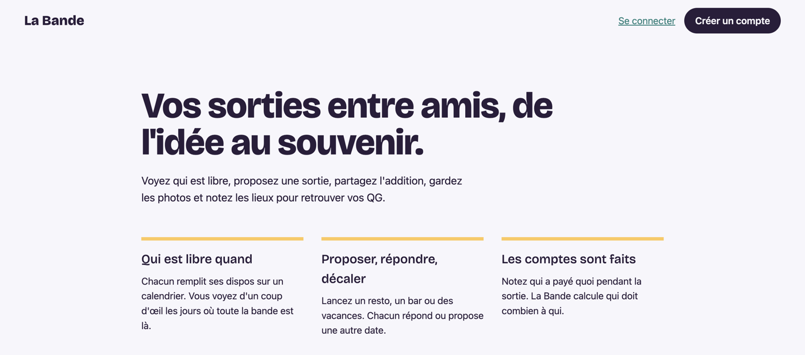
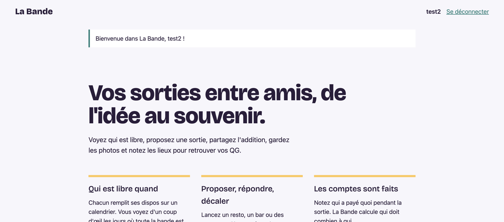
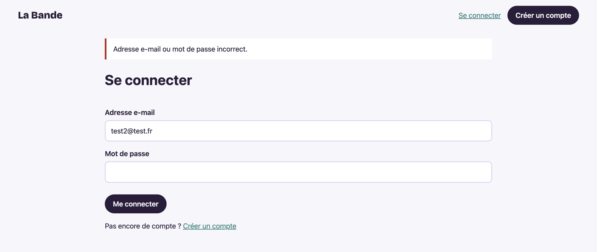
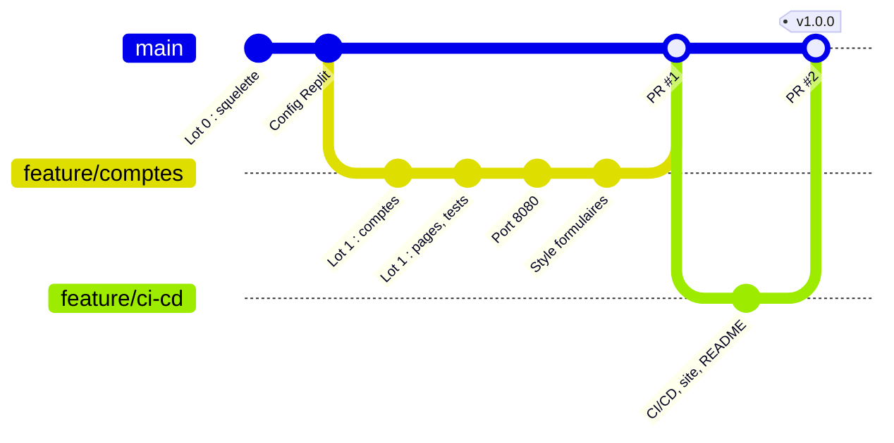

# La Bande

[](https://github.com/Valentedns/la-bande/actions/workflows/ci-cd.yml)
[](https://valentedns.github.io/la-bande/)

Application web tout-en-un pour les groupes d'amis : calendrier des dispos, propositions de sorties, dépenses partagées (façon Tricount), album photo par sortie et carte des lieux notés.

**Site de présentation :** https://valentedns.github.io/la-bande/



## Sommaire

- [Pourquoi La Bande](#pourquoi-la-bande)
- [Fonctionnalités](#fonctionnalités)
- [Captures d'écran](#captures-décran)
- [Installation](#installation)
- [Utilisation](#utilisation)
- [Tests](#tests)
- [Architecture Git et flux de travail](#architecture-git-et-flux-de-travail)
- [Chaîne CI/CD](#chaîne-cicd)
- [Sécurité](#sécurité)
- [Structure du projet](#structure-du-projet)
- [Contribuer](#contribuer)

## Pourquoi La Bande

Organiser une sortie entre amis, c'est aujourd'hui jongler entre plusieurs applis : une conversation de groupe pour proposer, un sondage pour trouver une date, Tricount pour les comptes, un album partagé pour les photos. La date finale se perd dans les messages, les remboursements s'oublient et personne ne se souvient du nom du bar d'il y a six mois.

La Bande réunit tout le cycle de vie d'une sortie au même endroit :

```
Dispos ─► Proposer une sortie ─► Chacun répond ─► Sortie confirmée
                                                        │
Carte des lieux notés ◄── Album photo ◄── Dépenses ◄────┘
```

## Fonctionnalités

| Lot | Fonctionnalité | Statut |
|---|---|---|
| 0 | Squelette du projet (Flask, base SQLite, page d'accueil) | ✅ v1.0.0 |
| 1 | Comptes utilisateurs : inscription, connexion, déconnexion | ✅ v1.0.0 |
| 2 | Groupes et codes d'invitation | À venir |
| 3 | Calendrier des disponibilités | À venir |
| 4 | Sorties : proposer, répondre, proposer une autre date | À venir |
| 5 | Dépenses partagées et remboursements | À venir |
| 6 | Carte des lieux et notes (QG, à refaire, bof, à éviter) | À venir |
| 7 | Album photo par sortie | À venir |

Le détail de chaque lot (critères de validation, modèle de données) est dans [SPEC.md](SPEC.md).

## Captures d'écran

| Inscription réussie | Mauvais mot de passe |
|---|---|
|  |  |

## Installation

Prérequis : Python 3.12 et Git.

```bash
git clone https://github.com/Valentedns/la-bande.git
cd la-bande
pip install -r requirements.txt
```

Définir une clé secrète (elle sert à signer les sessions de connexion) :

```bash
export SECRET_KEY="$(python -c 'import secrets; print(secrets.token_hex(32))')"
```

Sur Replit, la clé se met dans l'onglet **Secrets**, jamais dans le code. Sans clé, l'application en génère une temporaire et affiche un avertissement.

## Utilisation

```bash
python main.py
```

Puis ouvrir http://localhost:8080 : créer un compte, se déconnecter, se reconnecter.

Variables d'environnement disponibles :

| Variable | Rôle | Valeur par défaut |
|---|---|---|
| `SECRET_KEY` | Signature des sessions | clé temporaire |
| `PORT` | Port du serveur | `8080` |
| `DATABASE_PATH` | Fichier de base de données | `la_bande.db` |
| `FLASK_DEBUG` | Mode débogage (`1` pour l'activer) | désactivé |

## Tests

```bash
pytest -v
```

Les tests couvrent la base de données, les comptes (mot de passe jamais stocké en clair, e-mail en double refusé, formulaire sans jeton CSRF refusé…) et la page vitrine (HTML bien formé, aucun lien cassé).

## Architecture Git et flux de travail

Le projet suit un flux **une branche par fonctionnalité** : `main` contient toujours une version qui marche, et chaque lot est développé sur sa propre branche avant d'y être fusionné par une pull request relue.



Le code circule entre deux environnements, toujours en passant par GitHub :

1. **Replit** : développement du lot, puis `git commit` et `git push` sur la branche de la fonctionnalité.
2. **Ordinateur** : `git pull`, puis revue de code et de sécurité avec Claude Code, corrections, `git commit` et `git push`.
3. **GitHub** : pull request vers `main`, vérifiée automatiquement par GitHub Actions, puis fusion.
4. **Replit** : `git pull` pour repartir de la dernière version.

Les tâches sont suivies dans les [issues](https://github.com/Valentedns/la-bande/issues), et chaque version livrée est publiée en [release](https://github.com/Valentedns/la-bande/releases). L'historique des changements est dans [CHANGELOG.md](CHANGELOG.md).

## Chaîne CI/CD

Le workflow [`.github/workflows/ci-cd.yml`](.github/workflows/ci-cd.yml) tourne sur GitHub Actions :

| Étape | Quand | Ce qu'elle fait |
|---|---|---|
| **Tests automatiques** (CI) | À chaque push et à chaque pull request | Installe Python 3.12 et les dépendances, puis lance `pytest` |
| **Déploiement** (CD) | Quand `main` change, et seulement si les tests passent | Publie le dossier `site/` sur GitHub Pages |

L'application Flask a besoin d'un serveur Python : elle tourne sur Replit. GitHub Pages n'héberge que des pages statiques, il publie donc la page de présentation du projet.

## Sécurité

- Mots de passe hachés avec Werkzeug, jamais stockés en clair.
- Clé secrète lue depuis une variable d'environnement, jamais commitée.
- Protection CSRF sur tous les formulaires (`security.py`).
- Cookie de session inaccessible au JavaScript (`HttpOnly`, `SameSite=Lax`).
- Requêtes SQL toujours paramétrées.
- Le `.gitignore` exclut la base de données, les fichiers `.env` et les photos envoyées.

## Structure du projet

```
la-bande/
├── .github/workflows/ci-cd.yml   Chaîne CI/CD (tests + GitHub Pages)
├── main.py                       Point d'entrée de l'application Flask
├── auth.py                       Inscription, connexion, déconnexion
├── security.py                   Protection CSRF
├── database.py                   Connexion SQLite
├── schema.sql                    Schéma complet de la base
├── templates/                    Pages HTML (Jinja)
├── static/                       Feuille de style de l'application
├── site/                         Page vitrine publiée sur GitHub Pages
├── tests/                        Tests automatiques (pytest)
├── SPEC.md                       Spécification et découpage en lots
└── CHANGELOG.md                  Historique des versions
```

## Contribuer

1. Créer une issue qui décrit la tâche.
2. Créer une branche depuis `main` : `git switch -c feature/nom-de-la-fonctionnalite`.
3. Commiter avec des messages clairs (« Lot 2 : création des groupes »).
4. Pousser la branche et ouvrir une pull request vers `main` en citant l'issue (`Closes #3`).
5. Fusionner une fois les tests verts et la relecture faite.

---

Projet réalisé par Valentine Denis dans le cadre du module GitHub & CI/CD pour le no-code (École .decode).
